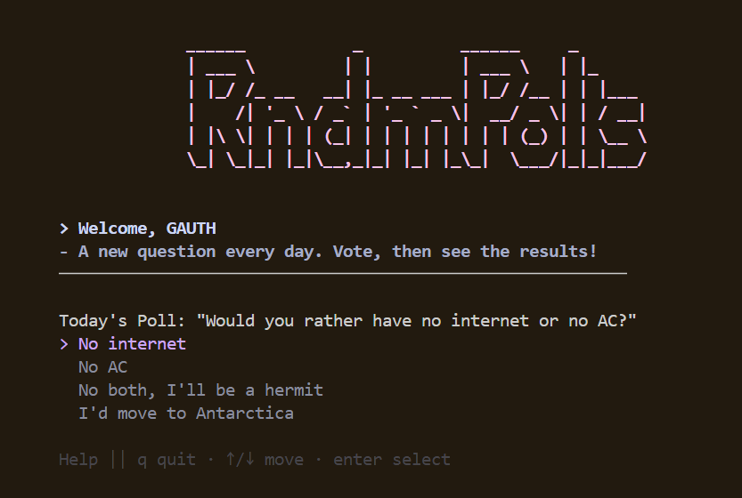
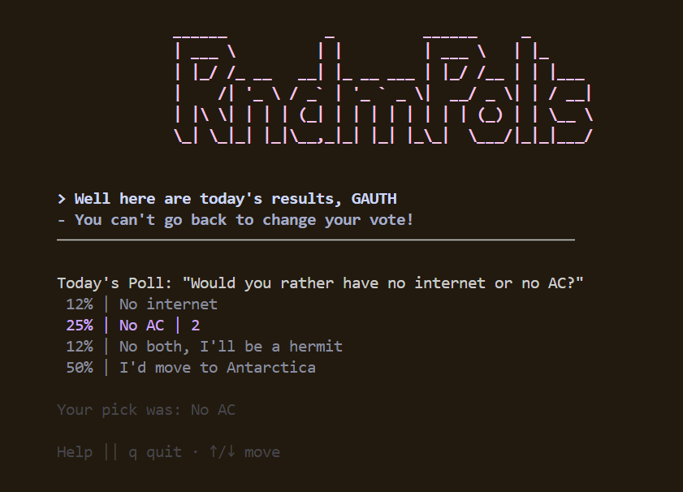

# RndmPolls

## What is this?
I wanted to make a simple ssh app that runs a new poll every day for anyone to submit their answers to.

## Usage

You can ssh into port 2222 on the following domain with this command:
```bash
ssh -p 2222 <USERNAME>@polls.gthn.cc
```

NOTE: Since Nest is only reachable on IPv6, your network needs IPv6 to actually connect (You can check at test-ipv6.com)


## Recompiling

You can build and run the polls server yourself (Requires Go 1.27+):
```bash
git clone https://github.com/GauthamRNair/RndmPolls.git
cd RndmPolls
go build -o rndmpolls .
./rndmpolls            
```

You can connect to it locally:
```bash
ssh -p 2222 <USERNAME>@localhost
```

NOTE: I intentionally discern different users by username only because these polls aren't too serious

## Preview


